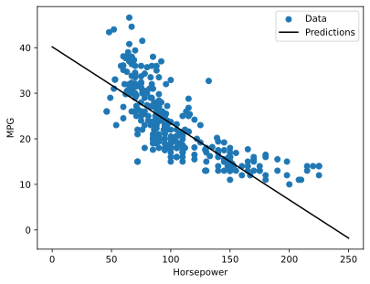
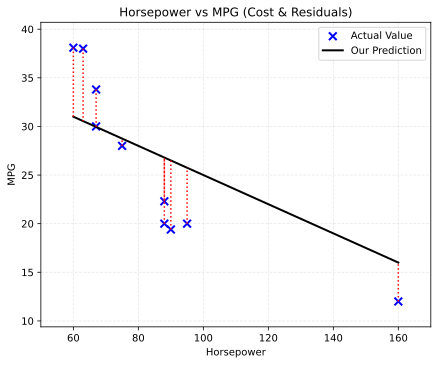
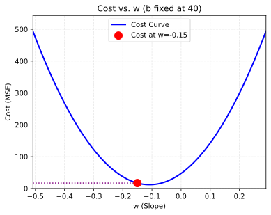
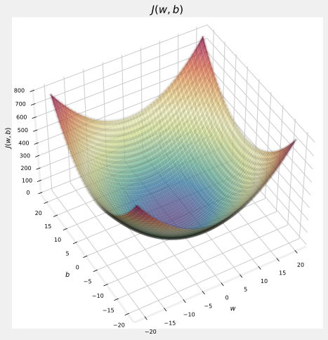
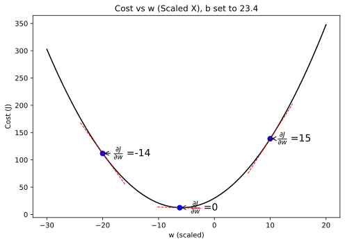
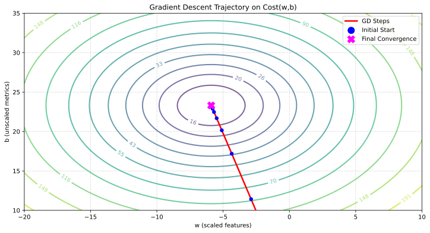

# Linear Regression Basics

## 1. Introduction
In machine learning, a regression problem is a type of supervised learning task where the goal is to predict a continuous, numerical output. Unlike classification problems—which sort data into distinct categories (like "spam" or "not spam")—regression answers the question: "How much?" or "How many?"
If you are trying to predict a specific number on an infinite scale—such as a house price, tomorrow’s temperature, stock market value, or a student's final exam score—you are dealing with a regression problem.

Linear Regression is the most foundational algorithm used to solve regression problems. It assumes a direct, straight-line relationship between your input features and the number you want to predict. Imagine drawing a straight line through a scatter plot of data points. Linear regression finds the "line of best fit" by minimizing the distance between the line and every single data point. It is used for simple predictable data where a change in the input results in a proportional, steady change in the output.

### 1.1 Univariate

#### 1.1.1 The model
In a univariate/univariable linear regression model you use exactly one input feature (\(x\)) to predict one output (\(y\)). Lets consider the example of predicting fuel efficiency of an automobile using the [Auto-mpg dataset](https://archive.ics.uci.edu/dataset/9/auto+mpg). Lets predict `mpg` (miles per gallon) (\(y\)) using only its `Horsepower` value (\(x\)). You are ignoring other factors like the cylinders or weight for now. In this case our model function would look like

$$f_{w,b}(x) = wx + b$$

Here

• \(x\) is the the Input Feature. This is the data you already know and feed into the model (e.g., the Horsepower of the automobile).

• \(f_{w,b}(x)\) is the the Prediction / Output. This represents the model's estimated guess based on the input \(x\). In machine learning, you will also frequently see this written as \(\hat{y}\) (pronounced "y-hat"). 

• \(w\) is the Weight. This is the slope of the line. It controls how steep the line is. Mathematically, it tells you how much the prediction changes for every one-unit increase in \(x\). For example if \(w = -0.15\), it means for every 1 additional horsepower an engine has, the car loses 0.15 miles per gallon.

• \(b\) is the Bias. This is the y-intercept or the point where the line crosses the vertical Y-axis (where \(x = 0\)). In practical terms, it represents a baseline starting value before the input feature is even considered. For example a bias \(b = 40\) represents a theoretical baseline maximum efficiency for an engine with minimal power.


Let’s say our model has already trained on historical data and calculated that the optimal parameters are \(w = -0.15\) and \(b = 40\). 
So if a user wants to predict the efficiency of a sporty vintage car with `120 horsepower`  \(x₁ = 120\), the model plugs the numbers right into the function:

\(f(120) = (-0.15 \times 120) + 40\)

or

\(\hat{y} = 22 \)

So the model predicts the fuel efficiency of the car as \(22 mpg\).



#### 1.1.2 The Cost Function

Up to this point, we’ve talked about how the model uses the function \(f_{w,b}(x) = wx + b\) to make a guess. But when a model first starts training, it has no idea what the correct numbers for \(w\) (weight) and \(b\) (bias) should be. It literally starts by guessing random numbers, which usually results in terrible predictions. To get better, the model needs a way to measure how wrong its guesses are. This is where the Cost Function comes in. Think of it as a mathematical function that scores the model's performance. The lower the score, the better the model.

In linear regression, the standard cost function that we use is called the `Mean Squared Error (MSE)` cost function, denoted as \(J(w, b)\).

\[
\begin{aligned}
J(w,b) &= \frac{1}{2m} \sum\limits_{i = 0}^{m-1} (f_{w,b}(x^{(i)}) - y^{(i)})^2 \\
f_{w,b}(x^{(i)}) &= wx^{(i)} + b
\end{aligned}
\]

where

- \(J(w,b)\) — The Cost. It represents the total penalty or "error score" for choosing a specific combination of \(w\) and \(b\). Our ultimate goal in machine learning is to minimize this value to as close to zero as possible.

- \(m\) — Total Number of Training Examples. For example, if you are analyzing 100 cars in the Auto MPG dataset, \(m = 100\).

- \(f_{w,b}(x^{(i)})\) — The Model's Prediction: This is the model’s calculated guess for the \(i\)-th car in your dataset.

- \(y^{(i)}\) — This is the actual target value (the real MPG) from your dataset for the \(i\)-th car/record.

- \((f_{w,b}(x^{(i)}) - y^{(i)})\) — difference between the target value and the prediction. If the model guesses a car gets 30 mpg, but it actually gets 25 mpg, the error is \(30 - 25 = 5\).

- \( (f_{w,b}(x^{(i)}) -y^{(i)})^2 \) - Squaring the error has two purposes
	- It eliminates negative numbers: An error of \(-5\) (guessing too low) and \(+5\) (guessing too high) shouldn't cancel each other out. Squaring turns both into a positive \(25\).
	- It penalizes big mistakes: If a guess is off by 2, the penalty is 4 (\(2^{2}\)). If it is off by 10, the penalty goes very high to 100 (\(10^{2}\)). This forces the model to prioritize fixing major errors.

- \(\frac{1}{2m}\) — Dividing by \(m\) to get the average squared error across your whole dataset so that a larger dataset doesn't automatically mean a larger cost. The extra division by \(2\) is just for ease of calculation in the step coming next

The Cost Function is a measure of distance. Imagine your real data points are dots on a graph, and your linear regression model is a straight string laid across them. The Cost Function measures the distance from every single dot to your string, squares those distances, and averages them out.



The model's entire training journey is about shifting and tilting that string until the average distance is as small as physically possible. It shows that if `w` and `b` can be selected such that the predictions \(f_{w,b}(x)\) match the target data `y`, the \((f_{w,b}(x^{(i)}) - y^{(i)})^2 \) term will be zero and the cost minimized.


The fact that the cost function squares the loss ensures that the 'error surface' is convex like a soup bowl. It will always have a minimum that can be reached by following the gradient in all dimensions. If we consider symmetric `w` and `b`, the cost curve is a bowl shape curve like below. 



#### 1.1.3 Gradient Descent
Gradient Descent is the optimization algorithm that linear regression uses to systematically adjust \(w\) and \(b\) which minimizes the cost. 

To find the values of \(w\) and \(b\) that minimize the cost, Gradient Descent runs a repetitive calculation loop:

$$\begin{align*} \text{repeat}&\text{ until convergence:} \; \lbrace \newline
\;  w &= w -  \alpha \frac{\partial J(w,b)}{\partial w}  \; \newline 
 b &= b -  \alpha \frac{\partial J(w,b)}{\partial b}  \newline \rbrace
\end{align*}$$

Think of it like being blindfolded on top of a rugged mountain (high cost) and needing to find your way down to a valley floor (the lowest possible cost, or the minimum). You can't see the valley, but you can feel the slope of the ground under your feet to determine which direction goes down.

In the equation

- \(\text{Repeat\ until\ convergence}\) means the algorithm keeps running the loop until the numbers barely change anymore. This means it has successfully reached the lowest point of the valley.

- The \(=\) indicates an update step. It means "Take the current value, calculate the adjustment, and overwrite it with the newly calculated value."

- \(\frac{\partial J(w,b)}{\partial w}\) and \(\frac{\partial J(w,b)}{\partial b}\) (The Gradients): These are partial derivatives from calculus. In practical terms, a gradient is just the direction and steepness of the slope. It tells the model whether it needs to increase or decrease \(w\) and \(b\) to go downhill.
When you apply calculus to our Mean Squared Error cost function, the exact math to calculate the slope for each parameter expands to this:
$$
\begin{align}
\frac{\partial J(w,b)}{\partial w}  &= \frac{1}{m} \sum\limits_{i = 0}^{m-1} (f_{w,b}(x^{(i)}) - y^{(i)})x^{(i)}\\
  \frac{\partial J(w,b)}{\partial b}  &= \frac{1}{m} \sum\limits_{i = 0}^{m-1} (f_{w,b}(x^{(i)}) - y^{(i)})\\
\end{align}
$$
Notice how similar these are to the cost function. They take the error \(\left( f_{w,b}(x^{(i)}) - y^{(i)} \right)\) for every single car, average it out over the whole dataset (\(\frac{1}{m}\)), and use that to dictate the step direction. The weight gradient also multiplies by the feature \(x^{(i)}\) because the scale of your input data directly impacts how much the slope changes.

- \(\alpha \) (The Learning Rate): This is a crucial parameter you tune when training a model. It controls how big of a step the algorithm takes down the hill to aproach the minima. The larger \( \alpha \) is, the faster gradient descent will converge to a solution. But, if it is too large, gradient descent will diverge.

 

 

### 1.2 Multivariate
While looking at horsepower alone gives us a rough estimate, a car's fuel efficiency is dictated by more than just engine power. To build a smarter model, we need multivariate (or multivariable) linear regression, which allows us to look at multiple clues at the same time. Every new feature gets its own unique weight (\(w\)) to represent its specific value or impact.

Lets consider three features now
- \(x_{1}\) = horsepower (Engine power)
- \(x_{2}\) = weight (Vehicle weight in pounds)
- \(x_{3}\) = model_year (Year manufactured, e.g., 82 for 1982)


So our model now becomes

$$ f_{w,b}(x)=w_{1}x_{1}+w_{2}x_{2}+w_{3}x_{3}+b\ $$

For any `n` number of features it would look like

$$ f_{\mathbf{w},b}(\mathbf{x}) =  w_0x_0 + w_1x_1 +... + w_{n-1}x_{n-1} + b $$
or in vector notation:
$$ f_{\mathbf{w},b}(\mathbf{x}) = \mathbf{w} \cdot \mathbf{x} + b$$ 
where \(\cdot\) is a vector `dot product` of

$$\mathbf{X} = 
\begin{pmatrix}
 x^{(0)}_0 & x^{(0)}_1 & \cdots & x^{(0)}_{n-1} \\ 
 x^{(1)}_0 & x^{(1)}_1 & \cdots & x^{(1)}_{n-1} \\
 \cdots \\
 x^{(m-1)}_0 & x^{(m-1)}_1 & \cdots & x^{(m-1)}_{n-1} 
\end{pmatrix}
$$
notation:
- \(\mathbf{x}^{(i)}\) is vector containing example i. \(\mathbf{x}^{(i)} = (x^{(i)}_0, x^{(i)}_1, \cdots,x^{(i)}_{n-1})\)
- \(x^{(i)}_j\) is element j in example i. The superscript in parenthesis indicates the example number while the subscript represents an element.  

* \(\mathbf{w}\) is a vector with `n` elements.
  - Each element contains the parameter associated with one feature.
  - notionally, we draw this as a column vector

$$\mathbf{w} = \begin{pmatrix}
w_0 \\ 
w_1 \\
\cdots\\
w_{n-1}
\end{pmatrix}
$$
* \(b\) is a scalar parameter. 

When you have `m` training examples, and there are `n` features, \(\mathbf{X}\) is a matrix with dimensions (`m`, `n`) (m rows, n columns).

The equation for the mean squared error cost function with multiple variables \(J(\mathbf{w},b)\) is:
$$J(\mathbf{w},b) = \frac{1}{2m} \sum\limits_{i = 0}^{m-1} (f_{\mathbf{w},b}(\mathbf{x}^{(i)}) - y^{(i)})^2 $$ 
where:
$$ f_{\mathbf{w},b}(\mathbf{x}^{(i)}) = \mathbf{w} \cdot \mathbf{x}^{(i)} + b $$ 


Here \(\mathbf{w}\) and \(\mathbf{x}^{(i)}\) are vectors supporting multiple features.

Gradient descent for multiple variables:

$$\begin{align*} \text{repeat}&\text{ until convergence:} \; \lbrace \newline\;
& w_j = w_j -  \alpha \frac{\partial J(\mathbf{w},b)}{\partial w_j}  \; & \text{for j = 0..n-1}\newline
&b\ \ = b -  \alpha \frac{\partial J(\mathbf{w},b)}{\partial b}  \newline \rbrace
\end{align*}$$

where, `n` is the number of features and  

$$
\begin{align}
\frac{\partial J(\mathbf{w},b)}{\partial w_j}  &= \frac{1}{m} \sum\limits_{i = 0}^{m-1} (f_{\mathbf{w},b}(\mathbf{x}^{(i)}) - y^{(i)})x_{j}^{(i)}  \\
\frac{\partial J(\mathbf{w},b)}{\partial b}  &= \frac{1}{m} \sum\limits_{i = 0}^{m-1} (f_{\mathbf{w},b}(\mathbf{x}^{(i)}) - y^{(i)})
\end{align}
$$

* `m` is the number of training examples in the data set
    
*  \(f_{\mathbf{w},b}(\mathbf{x}^{(i)})\) is the model's prediction, while \(y^{(i)}\) is the target value


## 2. Data preprocessing

### 2.1 Data Splitting (Train / Val / Test)
To prevent your linear regression model from simply memorizing the data (which leads to overfitting), you must divide your data into three distinct sets.

- `The Training Set (Typically ~70% of your data)` : This is the data that the model is tarined on. The Gradient Descent algorithm loops through this data continuously to adjust the weights (w) and biases (b) to lower the cost function.

 - `The Validation Set (Typically ~15% of your data)` :  While the model is training, you pass the validation data through the model to see how it performs on data it hasn't seen before. You use the validation score to twist your hyperparameter (like adjusting the learning rate α, changing the number of epochs, or deciding if you need polynomial curves).

- `The Test Set (Typically ~15% of your data)` : Once you are fully satisfied with your tuned model, you run the test set through it exactly once. This gives you an honest, unbiased score of how your model will perform in the real world.

### 2.2 Handling Empty Data
In real-world machine learning you will almost never get a perfectly clean data. There will be empty cells because a sensor failed, a survey participant skipped a question, or data was lost during transmission. Because linear regression models run on rigid vector algebra, a single empty cell will break the mathematical equations and cause your code to crash. In such cases we can

- `Remove the Data` : The quickest fix is to simply delete the incomplete records. If you have 1,000 cars and only 3 of them are missing their horsepower values, you can safely drop those 3 rows. If a specific column (like sunroof_dimensions) is missing data for 80% of the cars, that column is useless noise an it is best to drop the entire column. But remember that if you drop too many rows, you will starve your model of the information it needs to find the true line of best fit.

- `Statistical Imputation` : Instead of throwing data away, you can fill in the blanks using a statistical estimate calculated from the rest of the column.  Fill the empty cell with the average value of that feature across the rest of the dataset. Fill the blank with the middle value. This is highly recommended if the column has wild outliers

### 2.3 Feature Scaling
In our regression example, we introduced features like Horsepower (typically ranging from 40 to 250), Weight (ranging from 1,500 to 5,000 lbs), and Model Year (ranging from 70 to 82). Notice that their scales are completely mismatched.
Feature scaling is rescaling the dataset so the features have a similar range. Thats required so that the gradient decent works uniformly for all the feartures and hence faster. 
Some of the techniques that we can use
- `Max-Division Scaling` : Dividing each positive feature by its maximum value. A quick, simple method used when your data consists entirely of positive numbers. Target Range: 0 to 1.
\(x_i := \dfrac{x_i}{max} \)
- `Min-Max Scaling (Normalization)` : Rescale each feature by both its minimum and maximum values using (x-min)/(max-min). It normalizes features to the range of -1 and 1 and works for any features.
\(x_i := \dfrac{x_i - min}{max - min} \)
- `Mean normalization` : A variation of Min-Max scaling that centers the dataset's baseline directly around zero. \(x_i := \dfrac{x_i - \mu_i}{max - min} \) Where \(\mu \) is the mean/average value of the feature
- `Standardization (Z-score Normalization)` : A statistics-based approach that centers your data around the variance of the features instead of rigid min/max boundaries. After z-score normalization, all features will have a mean of 0 and a standard deviation of 1. To implement z-score normalization, adjust your input values as shown in this formula \(x^{(i)}_j = \dfrac{x^{(i)}_j - \mu_j}{\sigma_j} \tag{4}\)
where `j` selects a feature or a column in the \(\mathbf{X}\) matrix. \(µ_j\) is the mean of all the values for feature `(j)` and \(\sigma_j\) is the standard deviation of feature `(j)`.
$$
\begin{align}
\mu_j &= \frac{1}{m} \sum_{i=0}^{m-1} x^{(i)}_j\\
\sigma^2_j &= \frac{1}{m} \sum_{i=0}^{m-1} (x^{(i)}_j - \mu_j)^2
\end{align}
$$

### 2.4 Feature Engineering
Out of the box, linear regression provides a means of building models of the form \(f_{\mathbf{w},b} = w_0x_0 + w_1x_1+ ... + w_{n-1}x_{n-1} + b \tag{1}\). But sometimes, the raw features don't tell the whole story. Feature Engineering is the process of using your domain knowledge or intuition to create new features or transform existing ones so your linear regression model can make vastly superior predictions. If your features are non-linear or are combinations of features, you modify the input data to engineer the needed features.

It may not always be obvious which features are required. One could add a variety of potential features to try and find the most useful. For example \(y=w_0x_0 + w_1x_1^2 + w_2x_2^3+b\) .Next when we run Gradient descent it will pick the `correct` features for us by emphasizing its associated weight. For the above example it may happen that after fitting, the weight associated with the \(x^2\) feature is much larger than the weights for \(x\) or \(x^3\) as it is the most useful in fitting the data.
 
#### 2.4.1 Handling Categorical Data
Linear regression runs entirely on algebra, which means it cannot read text. What happens if you want to include the origin column (e.g., "USA", "Europe", "Japan") ?
In this case we use a feature engineering technique called `One-Hot Encoding` where we transform a single text column into multiple columns containing 0 or 1. For example if a car is from Japan, the engineered column Is_Japan gets a 1, while Is_USA and Is_Europe get a 0. The model can then assign a specific numerical weight to each geographic region!

## 3. The model
If you want to understand the implemenation of a Linear Regression model from scratch, [refer this notebook](https://github.com/rphukan/machine-learning-samples/blob/main/notebooks/regression/linear_regression_implementation.ipynb)

Otherwise using [TensorFlow ](https://www.tensorflow.org/guide/basics) this can be easily implemented as expalined below. Before that if you want to have an overviw of Tensorflow, read and complete [these notebboks](https://github.com/GoogleCloudPlatform/asl-ml-immersion/tree/master/asl_core/notebooks/introduction_to_tensorflow/solutions)  


A linear sequential model with one layer

```python
# instantiate the tf.keras.layers.Normalization and fit its state to train_features
normalizer = tf.keras.layers.Normalization(axis=-1)
normalizer.adapt(np.array(train_features))
# Build the Keras Sequential model:
horsepower_model = tf.keras.Sequential([
    normalizer,
    layers.Dense(units=1)
])


# Keras Model.compile with the loss and the optimizer. these define 
# what will be optimized (mean_absolute_error) and how (using the tf.keras.optimizers.Adam).
#horsepower_model.compile(optimizer=tf.keras.optimizers.Adam(learning_rate=0.1), loss='mean_absolute_error')

horsepower_model.compile(
  optimizer=tf.keras.optimizers.SGD(learning_rate=0.01),
  loss='mean_squared_error')

# Use Keras Model.fit to execute the training for 100 epochs:
history = linear_model.fit(
    train_features,
    train_labels,
    epochs=100,
    # Suppress logging.
    verbose=0,
    # Calculate validation results on 20% of the training data.
    validation_split = 0.2)
```
When compiling a Keras model, you must configure two vital arguments: the loss and the optimizer. 

### 3.1 Loss functions
The loss function is simply the practical name for the Cost Function we broke down earlier. It calculates how far the model's line is from the true data points.
- `mean_squared_error (MSE)` : The universal standard for regression. As we have seen, it squares the errors to heavily penalize large misses (tf.keras.losses.MeanSquaredError).
- `mean_absolute_error (MAE)` : An alternative choice. It measures the absolute distance without squaring them. It is great if your dataset has wild outliers that you don't want to over-influence your model (tf.keras.losses.MeanAbsoluteError).


### 3.2 Optimizer
The optimizer is the specific algorithmic flavor of Gradient Descent used to adjust your weights and biases.

- `SGD (Stochastic Gradient Descent)` : This is the classic gradient descent loop we discussed above.

- `Adam (Adaptive Moment Estimation)` : A smarter, industry-standard upgrade to SGD. Instead of using a rigid learning rate (\(\alpha \)), Adam automatically adjusts the learning rate dynamically for every single feature as it trains.


### 3.3 Evaluation metrics
Once Gradient Descent stops updating and you have your final weights (w) and biases (b), you need to test the model on data it has never seen before. The most common Evaluation Metrics are

- `MAE (Mean Absolute Error)` : This calculates the average absolute distance between the model's predictions and the true values. It is highly intuitive. If your model's MAE on the Auto MPG dataset is 2.5, it means that, on average, the model's fuel efficiency guesses are off by exactly 2.5 miles per gallon.

- `RMSE (Root Mean Squared Error)` : This takes the Mean Squared Error (our cost function value) and takes its square root to bring the units back to the original scale. Because it squares the errors before taking the root, RMSE penalizes large, flagrant mistakes much more harshly than MAE. If your model makes a few evastatingly bad predictions, RMSE will skyrocket, alerting you immediately.

- `R² Score (Coefficient of Determination)` : This outputs a value between 0 and 1 (or 0% to 100%) that measures how much of the variance in the target variable your model successfully explains. If your model has an R² score of 0.85, it means your input features (horsepower, weight, year) explain 85% of the variation in fuel efficiency.

## 4. Tuning

### 4.1 Hyperparameters
In our Keras code, we tweaked three main hyperparameters:
- `Learning Rate (learning_rate=0.01)` : The step size down the cost bowl. Twist it too high, and the model explodes; too low, and it takes hours to train.
- `Epochs (epochs=500)` : How many times the model looks at your entire dataset. If it looks too few times, it won't learn the line. If it looks too many times, it might over-memorize the data.
- `Batch Size` : The number of data points the model reviews before updating the weights.

### 4.2 Overfitting vs. Underfitting
- `Underfitting (High Bias)` : This mean the model is too simple to see the pattern. Imagine trying to fit a perfectly straight line through data that naturally curves like a crescent moon. This leads to bad performance on your training data and bad performance on new testing data. To fix it we increase model complexity (add engineered polynomial features like \(x^{2}\)), train for more epochs, or increase the learning rate if it was stuck.


- `Overfitting (High Variance)` : In this case the model is too smart for its own good. It draws a chaotic, jagged line that perfectly twists and turns to hit every single individual dot on your training graph, memorizing the random noise instead of the true trend. This leads to a perfect score on your training data, but completely crashes and makes terrible predictions when you give it new, unseen data. To fix this we can reduce the number of features, decrease the number of epochs, gather a larger training dataset, or use a technique called Regularization to penalize overly complex weights.
For regularized linear regression the Cost Function is
$$J(\mathbf{w},b) = \frac{1}{2m} \sum\limits_{i = 0}^{m-1} (f_{\mathbf{w},b}(\mathbf{x}^{(i)}) - y^{(i)})^2  + \frac{\lambda}{2m}  \sum_{j=0}^{n-1} w_j^2$$ 
where  \( f_{\mathbf{w},b}(\mathbf{x}^{(i)}) = \mathbf{w} \cdot \mathbf{x}^{(i)} + b \)   and  \(\frac{\lambda}{2m}  \sum_{j=0}^{n-1} w_j^2\)  is the regularization term. Including this term encourages gradient descent to minimize the size of the parameters. The parameter `b` is not regularized as a standard practice.

## 5. What is next
Linear Regression is mathematically forced to fit a straight line (or flat plane) through your data. You should use Polynomial Regression when your data shows a non-linear trend. Instead of forcing a straight line through a curved data path, polynomial regression adds powers to the input features (like squaring or cubing them: \(x^2, x^3\)). For example to predict Epidemic Growth Rates, the Disease transmission rates often curve upwards exponentially before flattening out.

A Deep Neural Network (DNN) Regression model uses an artificial neural network with multiple hidden layers to predict a continuous numerical value. Instead of relying on a single mathematical formula (like linear or polynomial lines), a DNN passes data through layers of interconnected "neurons." Each neuron applies a mathematical function to the data before sending it to the next layer. This allows the model to automatically learn incredibly complex, hidden patterns without you having to manually tell it how the data curves.

Conversely, if you are looking to predict a binary category (e.g., whether a transaction is "fraudulent" or "legitimate"), you should use logistic regression instead.
