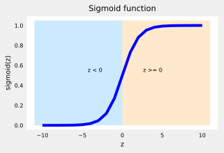
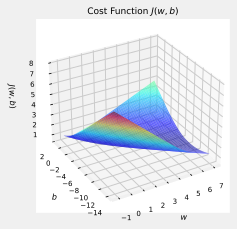
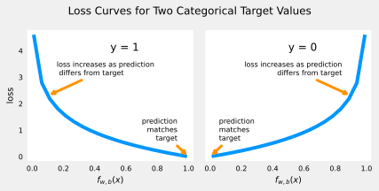

# Logistic Regression using Tensorflow

## 1. Logistic Regression

A sigmoid function  maps all input values to values between 0 and 1. The formula for a sigmoid function is

$$
\begin{align}
g(z) = \frac{1}{1+e^{-z}}
\end{align}
$$



Here
-  the input to the sigmoid function `z` is the output of a linear regression model. This is going to be scalar in case of single variable and a vector for a multi variable example
- \( 0 < g(z) < 1 \)

A logistic regression model applies the sigmoid above to the familiar linear regression model 

$$ f_{\mathbf{w},b}(\mathbf{x}^{(i)}) = g(\mathbf{w} \cdot \mathbf{x}^{(i)} + b ) $$ 

We interpret the output of the model \(f_{\mathbf{w},b}(x)\) as the probability that `y=1` given \(\mathbf{x}\) and parameterized by \(\mathbf{w}\) and `b`.

Here 
- \( g(z) = \frac{1}{1+e^{-z}} \) , \( z = \mathbf{w} \cdot \mathbf{x} + b \)

- \( \mathbf{X} = 
\begin{pmatrix}
 x^{(0)}_0 & x^{(0)}_1 & \cdots & x^{(0)}_{n-1} \\ 
 x^{(1)}_0 & x^{(1)}_1 & \cdots & x^{(1)}_{n-1} \\
 \cdots \\
 x^{(m-1)}_0 & x^{(m-1)}_1 & \cdots & x^{(m-1)}_{n-1} 
\end{pmatrix}
\)

- \( \mathbf{w} = \begin{pmatrix}
w_0 \\ 
w_1 \\
\cdots\\
w_{n-1}
\end{pmatrix}
\)
* \(b\) is a scalar parameter. 

When you have `m` training examples, and there are `n` features, \(\mathbf{X}\) is a matrix with dimensions (`m`, `n`) (m rows, n columns).

Logistic regression requires a cost function more suitable to its non-linear nature.
In a previous lab, you developed the *logistic loss* function. Recall, loss is defined to apply to one example. Here you combine the losses to form the **cost**, which includes all the examples.


For logistic regression the cost function is of the form 

$$ J(\mathbf{w},b) = \frac{1}{m} \sum_{i=0}^{m-1} \left[ loss(f_{\mathbf{w},b}(\mathbf{x}^{(i)}), y^{(i)}) \right]$$



where
* \( loss(f_{\mathbf{w},b}(\mathbf{x}^{(i)}), y^{(i)}) \) is the cost for a single data point, which is:

$$
\begin{align}
  loss(f_{\mathbf{w},b}(\mathbf{x}^{(i)}), y^{(i)}) &= -y^{(i)} \log\left(f_{\mathbf{w},b}\left( \mathbf{x}^{(i)} \right) \right) - \left( 1 - y^{(i)}\right) \log \left( 1 - f_{\mathbf{w},b}\left( \mathbf{x}^{(i)} \right) \right)\\
  &= \begin{cases}
    - \log\left(f_{\mathbf{w},b}\left( \mathbf{x}^{(i)} \right) \right) & \text{if $y^{(i)}=1$}\\
    - \log \left( 1 - f_{\mathbf{w},b}\left( \mathbf{x}^{(i)} \right) \right) & \text{if $y^{(i)}=0$}
  \end{cases}
\end{align}
$$

    
*  where `m` is the number of training examples in the data set, \(f_{\mathbf{w},b}(\mathbf{x}^{(i)})\) is the model's prediction, \(y^{(i)}\) is the target value and:
$$
\begin{align}
  f_{\mathbf{w},b}(\mathbf{x^{(i)}}) &= g(z^{(i)}) \\
  z^{(i)} &= \mathbf{w} \cdot \mathbf{x}^{(i)}+ b \\
  g(z^{(i)}) &= \frac{1}{1+e^{-z^{(i)}}} 
\end{align}
$$

Gradient descent for Logistic Regression

$$\begin{align*} \text{repeat}&\text{ until convergence:} \; \lbrace \newline\;
& w_j = w_j -  \alpha \frac{\partial J(\mathbf{w},b)}{\partial w_j}  \; & \text{for j = 0..n-1}\newline
&b\ \ = b -  \alpha \frac{\partial J(\mathbf{w},b)}{\partial b}  \newline \rbrace
\end{align*}$$

where, `n` is the number of features and  

$$
\begin{align}
\frac{\partial J(\mathbf{w},b)}{\partial w_j}  &= \frac{1}{m} \sum\limits_{i = 0}^{m-1} (f_{\mathbf{w},b}(\mathbf{x}^{(i)}) - y^{(i)})x_{j}^{(i)}  \\
\frac{\partial J(\mathbf{w},b)}{\partial b}  &= \frac{1}{m} \sum\limits_{i = 0}^{m-1} (f_{\mathbf{w},b}(\mathbf{x}^{(i)}) - y^{(i)})
\end{align}
$$

* `m` is the number of training examples in the data set
    
*  \(f_{\mathbf{w},b}(\mathbf{x}^{(i)})\) is the model's prediction, while \(y^{(i)}\) is the target value

* Here \(f_{\mathbf{w},b}(x) = g(z)\) and \(z = \mathbf{w} \cdot \mathbf{x} + b\) where \(g(z) = \frac{1}{1+e^{-z}}\) is the sigmoid function   


## 2. The model
A linear sequnecial model with one layer
```python
# instantiate the tf.keras.layers.Normalization and fit its state to train_features
normalizer = tf.keras.layers.Normalization(axis=-1)
normalizer.adapt(np.array(train_features))
# Build the Keras Sequential model:
horsepower_model = tf.keras.Sequential([
    normalizer,
    layers.Dense(units=1)
])


# Keras Model.compile with the loss and the optimizer. these define 
# what will be optimized (mean_absolute_error) and how (using the tf.keras.optimizers.Adam).
horsepower_model.compile(
    optimizer=tf.keras.optimizers.Adam(learning_rate=0.1),
    loss='mean_absolute_error')

# Use Keras Model.fit to execute the training for 100 epochs:
history = linear_model.fit(
    train_features,
    train_labels,
    epochs=100,
    # Suppress logging.
    verbose=0,
    # Calculate validation results on 20% of the training data.
    validation_split = 0.2)
```

A non-linear model with multiple hidden layers
```python
model = keras.Sequential([
      normalizer,
      layers.Dense(64, activation='relu'),  # Two hidden, non-linear, Dense layers with the ReLU (relu) activation function nonlinearity.
      layers.Dense(64, activation='relu'),
      layers.Dense(1)                       # A linear Dense single-output layer.
])

model.compile(loss='mean_absolute_error', optimizer=tf.keras.optimizers.Adam(0.001))

history = model.fit(
    train_features,
    train_labels,
    validation_split=0.2,
    verbose=0, epochs=100)
```

### Optimizer

### Loss functions
Mean squared error (MSE) (tf.keras.losses.MeanSquaredError) and mean absolute error (MAE) (tf.keras.losses.MeanAbsoluteError) are common loss functions used for regression problems. MAE is less sensitive to outliers. 

### Evaluation metrics


## 3. Tuning
### Hyper parameters

### Overfitting and regularization
The cost function for regularized logistic regression is
$$J(\mathbf{w},b) = \frac{1}{m}  \sum_{i=0}^{m-1} \left[ -y^{(i)} \log\left(f_{\mathbf{w},b}\left( \mathbf{x}^{(i)} \right) \right) - \left( 1 - y^{(i)}\right) \log \left( 1 - f_{\mathbf{w},b}\left( \mathbf{x}^{(i)} \right) \right) \right] + \frac{\lambda}{2m}  \sum_{j=0}^{n-1} w_j^2$$
where:
$$ f_{\mathbf{w},b}(\mathbf{x}^{(i)}) = sigmoid(\mathbf{w} \cdot \mathbf{x}^{(i)} + b) $$ 

Here \(\frac{\lambda}{2m}  \sum_{j=0}^{n-1} w_j^2\) is the regularization term. Including this term encourages gradient descent to minimize the size of the parameters The parameter `b` is not regularized as a standard practice.
